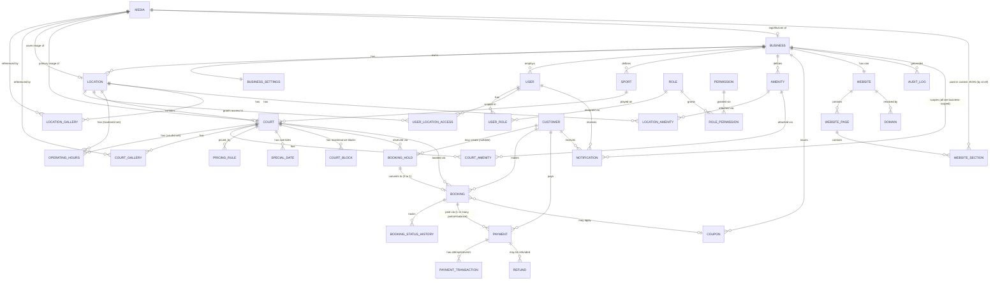

# Entity Relationships

Status: Draft for review — Phase 1
Related: [DATABASE_SCHEMA_PLAN.md](DATABASE_SCHEMA_PLAN.md)

Diagram uses Mermaid ER syntax (renders on GitHub and most doc viewers). Cardinality notation: `||` one-and-only-one, `o{` zero-or-many, `}o` many, `||--o{` one-to-many, `}o--o{` many-to-many (via join table, shown explicitly below instead of a direct m:n edge where the join table carries its own attributes).

---

## 1. Core ER Diagram

---

## 2. Entity Notes (why each relationship is shaped this way)

### Business is the single root
Every other table (directly or transitively) traces back to one `Business` row. Even though v1 has exactly one business, every table still carries this lineage so the data model does not need a breaking migration if the product ever becomes multi-tenant (see [ADR-0002](../decisions/0002-single-tenant-vs-multi-tenant.md)). In v1, application code enforces "there is exactly one Business row" rather than the schema enforcing single-tenancy structurally.

### User vs Customer are separate identity tables
Staff (Owner/Admin/Location Manager/Receptionist/Accountant) are `User` rows with `UserRole`/`UserLocationAccess`. End customers are a separate `Customer` table. Reasons:
- Customers never need RBAC/location-scoping — adding that machinery to every customer row would be waste and a security surface for no benefit.
- Guest checkout requires a "customer" that may not have credentials at all; modeling that as a `User` would force nullable-password weirdness into the staff auth table.
- A phone/email can appear as both a `Customer` and (separately, later) a `User` if a staff member also books as a customer — these are intentionally decoupled identities, not a shared row.

Both share the same JWT-issuing `auth` module and `AuthSession`/refresh-token mechanics, just against two different principal tables (the JWT payload carries a `principalType: 'user' | 'customer'` discriminator).

### Role/Permission is many-to-many via `RolePermission`, not a hardcoded enum
Roles map 1:1 to the brief's fixed catalog in v1 (Owner, Admin, Location Manager, Receptionist, Accountant, Customer-is-implicit), but permissions are granular rows (`booking:create`, `pricing:update`, `refund:approve`, …) assembled into roles via `RolePermission`. This lets a future "custom role" feature ship as a UI change only, no schema change.

### Location-scoping is its own join table, not a column on User
`UserLocationAccess(userId, locationId)` is separate from `UserRole` because a user's **role** (what they can do) and their **scope** (where they can do it) are orthogonal: a Location Manager might be scoped to 2 of 5 locations; Owner/Admin roles are checked as "global" in application logic (no rows needed, or a convention of granting all current+future locations — decision: **no rows for global roles**, the guard short-circuits on role, avoiding a sync problem when new locations are created).

### `OperatingHours` is shared by Location and Court via nullable FKs
Rather than duplicating a day/time-range table twice, one `OperatingHours` table has nullable `locationId` and `courtId`, with a check constraint that **exactly one** of the two is set per row. A court's effective hours are the intersection of its own `OperatingHours` rows (if any exist) and its location's — if a court defines none, it inherits the location's hours entirely. This is called out explicitly because it's a common source of ambiguity: see [DATABASE_SCHEMA_PLAN.md](DATABASE_SCHEMA_PLAN.md) §"Operating Hours Resolution".

### `BookingHold` and `Booking` are separate tables, not one table with a HOLD status
This was reviewed deliberately (see [ADR-0004](../decisions/0004-hold-vs-booking-separate-tables.md)). Keeping them separate means:
- The hot-path table (`BookingHold`) that gets many short-lived inserts/deletes per day stays small and fast, independent of `Booking`'s long-term growth and reporting indexes.
- The exclusion constraint guarding "no overlap" can be defined once per table with a simpler active-status predicate, instead of one constraint that has to reason about 8 different `Booking` statuses *and* holds together.
- A hold converting to a booking is an explicit, auditable event (`BookingHold.status = CONVERTED`, `BookingHold.bookingId` set) rather than an in-place status mutation that would lose the distinction between "this was once a hold" and "this was a direct walk-in booking."

The tradeoff — two places to check for conflicts — is handled by a single `AvailabilityService` method that always queries both, never one in isolation (see [TEMPORARY_SLOT_LOCKING.md](../workflows/TEMPORARY_SLOT_LOCKING.md)).

### `Booking.pricingSnapshot` is denormalized JSON, intentionally
`Booking` stores the resolved price breakdown (base rate, rule applied, coupon applied, tax if any, final total) as a JSON snapshot at booking-confirmation time, *in addition to* the normalized `PricingRule`/`Coupon` FKs (kept for traceability/reporting "which rule got used how often"). This is the brief's explicit requirement (§7: "historical bookings do not change when prices are updated") — normalized-only would break that guarantee the moment a `PricingRule` row is edited.

### Payment vs Booking state machines are independent, linked by `bookingId`
`Payment` does not have a status that mirrors `Booking.status`. A `Booking` can be `PENDING` (awaiting manual approval) while its `Payment` is already `CAPTURED` (prepaid, awaiting owner approval) — these are genuinely independent axes. See [PAYMENT_LIFECYCLE.md](../workflows/PAYMENT_LIFECYCLE.md) for the full cross-product of states and which combinations are valid/invalid.

### `PaymentTransaction` vs `Payment`
`Payment` is the logical "this booking owes/paid this much" record (one or more per booking — e.g., advance + balance-at-venue). `PaymentTransaction` is the append-only log of every Razorpay event/attempt against a `Payment` (order created, attempt failed, attempt succeeded, webhook received) — needed for idempotent webhook handling and reconciliation audit trail, and never updated in place, only inserted.

### Media is referenced, not owned, by gallery tables
`LocationGallery`/`CourtGallery` are thin join rows (`mediaId`, `sortOrder`, owning entity id) rather than `Media` having a hard FK to "its" location — because the same `Media` row conceptually could be reused (e.g., a facility icon shared across courts) and because deleting a gallery entry should not require deleting the underlying `Media`/S3 object if it's still referenced elsewhere. Primary/cover image fields on `Location`/`Court`/`Business` are direct nullable FKs to `Media` for the single "the" image case.

### Website/WebsitePage/WebsiteSection nesting mirrors the builder's structure
`Website` (one per business) → `WebsitePage` (home, about, contact, custom pages) → `WebsiteSection` (ordered blocks: hero, gallery, testimonials, etc., each with a `type` discriminator and a JSON `content` payload validated against a per-type zod schema). Both `WebsitePage` and `WebsiteSection` carry **draft and published** content (see [WEBSITE_BUILDER.md](../architecture/WEBSITE_BUILDER.md) for whether this is dual-columns vs a version table — decision: a `WebsiteVersion` snapshot table, detailed there).

### Domain resolves to Website (not directly to Business)
`Domain.websiteId` not `Domain.businessId`, even though v1 has one website per business — because hostname resolution's actual job is "which rendered config do I serve," and keeping that FK pointed at `Website` means the resolution path never needs a join through `Business` at request time.

---

## 3. Relationship Cardinality Reference Table

| Parent | Child | Cardinality | Notes |
|---|---|---|---|
| Business | Location | 1:N | |
| Business | User | 1:N | Staff only |
| Business | Sport | 1:N | Business-managed catalog |
| Business | Amenity | 1:N | Business-managed catalog |
| Business | Coupon | 1:N | |
| Business | Website | 1:1 | |
| Location | Court | 1:N | |
| Location | OperatingHours | 1:N | nullable-FK shared table |
| Location | LocationGallery | 1:N | → Media (N:1) |
| Location, Amenity | LocationAmenity | M:N join | |
| Court, Amenity | CourtAmenity | M:N join | |
| Sport | Court | 1:N | |
| Court | PricingRule | 1:N | |
| Court | SpecialDate | 1:N | |
| Court | CourtBlock | 1:N | Maintenance windows |
| Court | BookingHold | 1:N | |
| Court | Booking | 1:N | |
| Customer | BookingHold | 0/1:N | Nullable — guest holds have `sessionId` only |
| Customer | Booking | 1:N | |
| BookingHold | Booking | 0..1:1 | Set only on conversion |
| Booking | BookingStatusHistory | 1:N | Append-only audit trail |
| Booking | Payment | 1:N | Advance + balance can be 2 rows |
| Payment | PaymentTransaction | 1:N | Append-only |
| Payment | Refund | 1:N | Supports partial refunds |
| User | UserRole | 1:N | |
| Role | RolePermission | 1:N | → Permission N:1 |
| User, Location | UserLocationAccess | M:N join | |
| Website | WebsitePage | 1:N | |
| WebsitePage | WebsiteSection | 1:N | |
| Website | Domain | 1:N | One primary subdomain + optional custom domains |
| Business | AuditLog | 1:N | |

---

## 4. Referential Integrity Rules Worth Calling Out

1. **No hard deletes** on Booking, Payment, Refund, Customer, AuditLog, PricingRule history — soft delete (`deletedAt`) or, for Booking/Payment, never deleted at all (only status-transitioned).
2. **Court → Location** FK is `ON DELETE RESTRICT` (a location with courts cannot be hard-deleted; use the `active` flag).
3. **BookingHold → Court/Customer** are `ON DELETE RESTRICT`/`SET NULL` respectively (deleting a customer record — e.g. GDPR-style erasure — nulls `customerId` on historical holds/bookings but keeps the booking row and an anonymized snapshot for financial record-keeping).
4. **PricingRule edits never retroactively change `Booking.pricingSnapshot`** — enforced by application logic (snapshot is copied at write time), not by the schema, but documented here because it's the single most important invariant from §7 of the brief.
