# Booking Lifecycle

Status: Draft for review — Phase 1
Related: [TEMPORARY_SLOT_LOCKING.md](TEMPORARY_SLOT_LOCKING.md) · [PAYMENT_LIFECYCLE.md](PAYMENT_LIFECYCLE.md) · [DATABASE_SCHEMA_PLAN.md](../database/DATABASE_SCHEMA_PLAN.md)

## 1. Reconciling the brief's 8 statuses with two tables

The brief specifies `Booking` statuses as: `HOLD, PENDING, CONFIRMED, REJECTED, CANCELLED, COMPLETED, EXPIRED, NO_SHOW`. Our schema splits reservation into two tables (`BookingHold` and `Booking` — rationale in [ENTITY_RELATIONSHIPS.md](../database/ENTITY_RELATIONSHIPS.md)). The mapping:

| Brief status | Where it actually lives | Notes |
|---|---|---|
| HOLD | `BookingHold.status = ACTIVE`, **no `Booking` row exists yet** | A customer mid-checkout has a hold, not a booking. The public "my bookings" / staff calendar views treat an active hold as a provisional, non-authoritative placeholder — shown distinctly from real bookings, never counted in revenue/occupancy reports. |
| PENDING | `Booking.status = PENDING` | Created the moment a hold converts, when the location/court's approval mode is MANUAL, or payment method is PAY_AT_VENUE pending owner confirmation. |
| CONFIRMED | `Booking.status = CONFIRMED` | Auto-confirm mode, or manual approval granted, or full/advance payment captured where confirmation is payment-triggered. |
| REJECTED | `Booking.status = REJECTED` | Owner/staff declines a PENDING booking (manual-approval mode only). |
| CANCELLED | `Booking.status = CANCELLED` | Customer- or staff-initiated, subject to cancellation-window policy. |
| COMPLETED | `Booking.status = COMPLETED` | Set by staff check-in→complete action, or an automated job that marks past CONFIRMED bookings complete after `endAt` if no explicit no-show was recorded. |
| EXPIRED | Realized as `BookingHold.status = EXPIRED` (hold never converted) — **no `Booking` row is created for an expired hold.** A `Booking.status = EXPIRED` value is reserved in the enum only for the edge case in §5 (late payment after reassignment) where a booking did briefly exist and must be terminally marked rather than deleted. | This asymmetry is intentional and documented so implementers don't "fix" it by trying to create a Booking row for every expired hold (which would pollute booking history/reporting with non-events). |
| NO_SHOW | `Booking.status = NO_SHOW` | Staff marks after `endAt + noShowGraceMinutes` with no check-in; or an automated job proposes it and staff confirms (configurable; default: automated, staff can override within 24h). |

## 2. State Diagram

```mermaid
stateDiagram-v2
    [*] --> ActiveHold: customer selects slot\n(BookingHold created)
    ActiveHold --> Expired_NoBooking: 5 min elapses,\nno conversion
    ActiveHold --> Released_NoBooking: customer abandons /\npicks different slot
    ActiveHold --> PENDING: hold converts\n(manual approval OR\npay-at-venue pending)
    ActiveHold --> CONFIRMED: hold converts\n(auto-confirm AND\npayment captured, if required)

    PENDING --> CONFIRMED: owner approves
    PENDING --> REJECTED: owner rejects
    PENDING --> CANCELLED: customer cancels\nbefore approval

    CONFIRMED --> CANCELLED: cancellation\n(within/after policy window)
    CONFIRMED --> COMPLETED: check-in + court time elapses\n(or auto-complete job)
    CONFIRMED --> NO_SHOW: no check-in by\nendAt + grace period

    REJECTED --> [*]
    CANCELLED --> [*]
    COMPLETED --> [*]
    NO_SHOW --> [*]
    Expired_NoBooking --> [*]
    Released_NoBooking --> [*]

    CONFIRMED --> PENDING: reschedule requested\n(new hold created on new slot;\noriginal only mutated on success)
```

Walk-in bookings created by staff (`source = WALK_IN`/`STAFF_MANUAL`) skip `ActiveHold` and enter directly at `PENDING` or `CONFIRMED` per the same approval-mode rule, after passing through the identical pricing + conflict-check transaction as the online flow (no shortcut around the exclusion constraint — a walk-in still inserts into `bookings` and is still subject to `excl_active_booking_overlap`).

## 3. Transition Rules & Guards

| Transition | Guard |
|---|---|
| ActiveHold → PENDING/CONFIRMED | Hold must be `status = ACTIVE` and `expires_at > now()` at the instant of conversion, inside the same transaction that inserts the `Booking` row and flips the hold to `CONVERTED` (see Payment Lifecycle / Slot Locking for exact transaction boundaries). |
| PENDING → CONFIRMED/REJECTED | Only by a staff user with `booking:approve` **and** location-scope for this booking's location. |
| → CANCELLED | Customer: only their own booking, only if `now() < startAt - cancellationWindowHours`. Staff: can override the window but the override is audit-logged with a reason. |
| CONFIRMED → COMPLETED | Only after `endAt` has passed (cannot mark complete early) — guards against accidental early completion hiding a still-in-progress booking from the live calendar. |
| → NO_SHOW | Only after `endAt + noShowGraceMinutes`, and only if `checkInAt IS NULL`. |
| reschedule | Implemented as: (1) create a new `BookingHold` for the new slot — this alone proves the new slot is free via the exclusion constraint; (2) on successful hold creation, re-run pricing for the new slot; (3) in one transaction: insert new `Booking` (status mirrors original's pre-reschedule status or PENDING if price changed and policy requires re-approval), set `rescheduledFromBookingId`, mark original `Booking.status = CANCELLED` with `cancellationReason = 'RESCHEDULED'`, convert the new hold. If step 1 fails (new slot unavailable), the original booking is untouched — **never a blind move that could leave the customer with neither slot.** |

## 4. Approval Mode Resolution

Effective approval mode for a booking = `Court.bookingApprovalModeOverride` ?? `Location.bookingApprovalModeOverride` ?? `BusinessSettings.defaultBookingApprovalMode`. Resolved once, server-side, at conversion time — never cached across the hold's lifetime in case an owner changes the setting mid-hold (acceptable: a 5-minute window of setting-change is a non-issue, but resolving at conversion rather than hold-creation is simpler and avoids having to invalidate in-flight holds on a settings change).

## 5. Interaction With Late/Race-Condition Payments

If a `Booking` was briefly created (e.g., `PENDING` awaiting payment confirmation) and the payment later resolves against a slot that has since been given to someone else (see [PAYMENT_LIFECYCLE.md](PAYMENT_LIFECYCLE.md) §"Late payment after hold expiry/reassignment"), that orphaned `Booking` row is transitioned to `EXPIRED` (the one legitimate use of that status on the `Booking` table itself) rather than deleted, so the payment-to-booking audit trail stays intact and the reconciliation queue has something concrete to point at.

## 6. Reporting Implications

- **Occupancy/revenue reports count only `CONFIRMED` and `COMPLETED` bookings.** `PENDING` shows separately as "awaiting approval," never blended into revenue until approved.
- **Booking funnel report** (hold created → converted → expired/released) is the one place `BookingHold` rows are aggregated directly, joined against their eventual `Booking` outcome where one exists.
