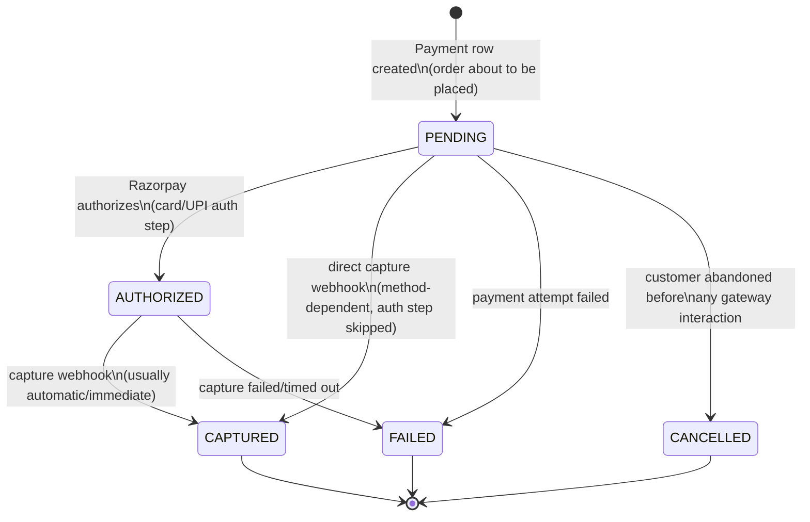

# Payment Lifecycle

Status: Draft for review — Phase 1
Related: [TEMPORARY_SLOT_LOCKING.md](TEMPORARY_SLOT_LOCKING.md) §7 · [BOOKING_LIFECYCLE.md](BOOKING_LIFECYCLE.md) · [DATABASE_SCHEMA_PLAN.md](../database/DATABASE_SCHEMA_PLAN.md) §6

## 1. Principle: Payment and Booking State Machines Are Independent

`Payment.status` and `Booking.status` are tracked on separate tables with no shared enum and no implicit coupling beyond the `bookingId` FK. A `Booking` can be `PENDING` while its `Payment` is `CAPTURED` (prepaid, awaiting manual owner approval); a `Booking` can be `CONFIRMED` with `Payment.status = PENDING` (PAY_AT_VENUE, approved on trust); a `CONFIRMED` booking can have a `FAILED` payment attempt followed by a successful retry (multiple `Payment`/`PaymentTransaction` rows against the same booking). The service layer defines the **valid combinations** explicitly (table below) rather than inferring one status from the other.

## 2. Payment States



Refunds are tracked on the separate `Refund` table (REQUESTED → PROCESSING → COMPLETED/FAILED), referencing a `CAPTURED` `Payment` — a `Payment` itself never transitions "backwards" to a refunded state; `Payment.status` stays `CAPTURED` and the refund history is read from its `Refund` rows (a captured-then-fully-refunded payment is still, factually, a payment that was captured — the refund is a separate, additive fact).

## 3. Valid (Booking.status, Payment.status) Combinations

| Booking.status | Valid Payment.status values | Notes |
|---|---|---|
| (no Booking row — still a Hold) | PENDING (order placed, awaiting webhook) or none yet | See Slot Locking §7.3 for why no Booking row exists at this stage for online payments |
| PENDING | CAPTURED (prepaid, awaiting approval) / PENDING (pay-at-venue, awaiting approval) | |
| CONFIRMED | CAPTURED (full or advance) / PENDING (pay-at-venue, approved) | An advance-paid CONFIRMED booking will later get a second `Payment` row (type BALANCE) collected at/before the venue visit |
| REJECTED | CAPTURED (must be refunded — triggers an automatic refund-eligible flag, though actual refund still requires `refund:approve`) / PENDING (nothing to refund) | |
| CANCELLED | CAPTURED (refund per cancellation policy — may be partial per policy, e.g. late cancellation forfeits a %) / PENDING / FAILED | |
| COMPLETED | CAPTURED (fully settled) / PENDING (venue collected cash, reconciled manually by Accountant marking it CAPTURED with method CASH) | |
| EXPIRED | CAPTURED with `reconciliationFlag=true` (the late-payment race case) | The one case where Payment is "ahead of" Booking's terminal state — see Slot Locking §7.3 |
| NO_SHOW | CAPTURED (policy-dependent forfeiture, owner-discretionary refund) | |

Any combination not in this table is treated as a data-integrity error and raises an alert (caught by a scheduled consistency-check job in Phase 11/12, not just left to surface as a user-facing bug later).

## 4. End-to-End Sequence — Full/Advance Online Payment

```
1. Customer completes checkout form on an ACTIVE hold → POST /bookings/from-hold
   { reservationToken, customerInfo, paymentMethod: 'RAZORPAY', paymentType: 'FULL'|'ADVANCE' }
2. Server: re-validate hold (ACTIVE, unexpired) → resolve amount due (full price or
   advancePercent × price, per Court/Location/Business config) → create Payment
   (status=PENDING, type=FULL|ADVANCE, amount) → create Razorpay Order via Razorpay API
   → store razorpayOrderId on Payment → return { paymentId, razorpayOrderId, amount,
   razorpayKeyId } to client. NO Booking row yet.
3. Client opens Razorpay Checkout with the order id; customer completes payment.
4. Razorpay sends a webhook: payment.captured (and/or order.paid).
5. POST /payments/webhook/razorpay:
   a. Verify signature using the webhook secret (reject with 400 if invalid — never processed).
   b. Extract razorpay event id; attempt INSERT into PaymentTransaction with that id.
      If it violates the unique constraint → already processed → return 200, stop.
   c. BEGIN TRANSACTION:
      - Re-fetch the BookingHold by the token/id correlated to this Payment (stored at
        order-creation time). Check status='ACTIVE' AND expires_at > now().
      - If valid: insert Booking (status per approval-mode resolution), set
        BookingHold.status='CONVERTED' + booking_id, set Payment.status='CAPTURED'.
      - If invalid (expired/converted-to-other/released): execute the
        late-payment-reconciliation path (Slot Locking §7.3) instead — Payment still
        marked CAPTURED (money moved), reconciliationFlag=true, no Booking inserted,
        Owner/Admin/Accountant notified.
   d. COMMIT.
   e. Enqueue: payment-receipt notification job, booking-confirmation notification job
      (only if a Booking was actually created/confirmed).
6. Client, which has been polling or awaiting a webhook-driven websocket/short-poll signal
   on GET /bookings/from-hold-status?reservationToken=, sees the booking confirmation and
   navigates to the confirmation page. The client's own "payment succeeded" callback from
   Razorpay Checkout is NEVER trusted to directly confirm the booking — it only triggers
   this status poll. The webhook is the only source of truth for confirmation.
```

## 5. Pay-at-Venue Sequence

```
1. POST /bookings/from-hold { reservationToken, customerInfo, paymentMethod: 'PAY_AT_VENUE' }
2. Server: re-validate hold → create Booking immediately (status per approval mode) →
   create Payment (status=PENDING, type=PAY_AT_VENUE, method=CASH placeholder until
   actually collected) → convert hold (CONVERTED) — all in one transaction, since there's
   no external gateway round-trip to wait on.
3. At check-in or completion, staff marks the Payment as CAPTURED (method may be updated
   to CASH/OTHER/RAZORPAY if they actually pay by card/UPI in person via a staff-initiated
   Razorpay order) via POST /payments/:id/collect-balance or a dedicated
   POST /payments/:id/mark-collected (staff-only, `payment:collect` permission, audit-logged).
```

## 6. Partial Advance + Balance Collection

- `Booking` created against an `ADVANCE` `Payment` (captured online). A second `Payment` row (`type=BALANCE`, status=PENDING) is created at the same time, representing the outstanding amount, visible to the customer (receipt shows "paid ₹X of ₹Y, balance due at venue") and to staff (Payments dashboard "outstanding dues" view, backed by `reports/outstanding-dues`).
- Balance can be collected: (a) at venue by staff marking it collected (cash/card), or (b) the customer can pay it online in advance via `POST /payments/:id/initiate` on the BALANCE payment before arrival. Either path converges on the same `Payment.status=CAPTURED` outcome, logged via a new `PaymentTransaction`.

## 7. Refund Flow

```
1. Staff (refund:approve) initiates: POST /refunds { paymentId, amount, reason }
   - amount must be <= (payment.amount - sum of existing non-FAILED Refunds for that payment)
2. Server creates Refund (status=REQUESTED) → calls Razorpay refund API → on success,
   updates to PROCESSING with razorpayRefundId, or directly COMPLETED if Razorpay returns
   a synchronous success (method-dependent).
3. Razorpay sends a refund webhook (refund.processed / refund.failed) → same signature +
   idempotency handling as payment webhooks → updates Refund.status accordingly.
4. On COMPLETED: enqueue a refund-confirmation notification to the customer.
5. Failed refunds surface in the dashboard's Refunds screen with a retry action (staff-
   initiated, not automatic, since repeated auto-retry against a gateway failure risks
   duplicate refund attempts if the failure reporting itself is unreliable).
```

Partial refunds are just `Refund.amount < Payment.amount`; multiple partial refunds against one `Payment` are summed and validated against the cap in step 1.

## 8. Webhook Idempotency & Signature Verification (restated precisely)

- Every inbound webhook request's raw body + `X-Razorpay-Signature` header is verified against `HMAC-SHA256(rawBody, webhookSecret)` **before any JSON parsing/processing** — if verification fails, respond 400 and log a security event; never process an unverified payload.
- `PaymentTransaction.razorpayEventId` (Razorpay's `event.id`, not `payment.id` — an event id is unique per delivery attempt's logical event) carries the unique constraint that makes reprocessing a no-op. Razorpay's own retry policy (exponential backoff on non-2xx) means our handler must always return 2xx once an event is durably recorded, even if downstream processing (e.g., a notification enqueue) partially fails — those failures are retried via the job queue, not by re-triggering webhook processing.

## 9. Historical Price Integrity Under Payment Confirmation

Per brief §7/§9, the amount charged is whatever was in the `Booking.pricingSnapshot`/the `Payment.amount` set at hold-creation/order-creation time. If a `PricingRule` changes between hold creation and webhook confirmation (a multi-minute window at most, bounded by the 5-minute hold TTL), the webhook handler **never re-resolves pricing** — it only verifies the captured amount matches what was already recorded on the `Payment` row at order-creation time (`razorpay order.amount == Payment.amount`, both in minor units/paise, compared as integers to avoid float issues). A mismatch is treated as `PAYMENT_VERIFICATION_FAILED` and routed to the reconciliation queue rather than silently accepted.
